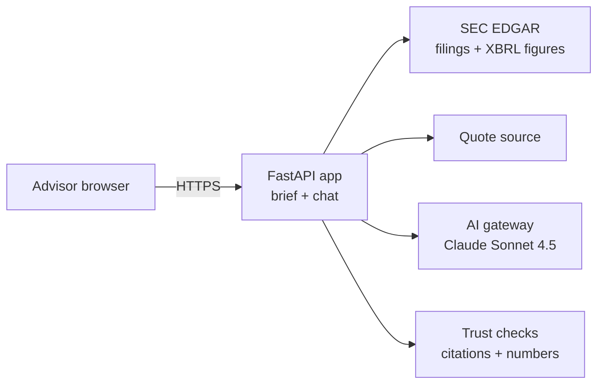

# TickerAgent

A one-page stock brief for wealth advisors, built from the live quote and the company's latest SEC filings. Every statement links to the filing it came from.

An advisor types a ticker and gets, in under a minute:

- **Quote**: price, day change, 52-week range, 12-month trend.
- **Key figures**: revenue, net income, diluted EPS, operating cash flow, debt and cash for the latest fiscal year vs. prior. Read from the company's XBRL data, never generated by the model.
- **AI summary**: what the company does, what's new, what's driving results, key risks, and questions a client may ask, drawn from the latest 10-K, any newer 10-Q, and 8-Ks from the last 120 days (including earnings press releases).
- **Sources**: each point carries a source tag that opens the filing on SEC.gov.
- **Chat with the data**: follow-up questions in plain English ("Why did margins fall?", "What did the last 8-K say?", "How has the stock moved since earnings?"), answered from the same filings, figures and recent prices, with sources.

One screen, no training: a ticker box, the brief, and a chat panel with suggested questions.

## Status

| Capability | Status |
| --- | --- |
| Brief: quote, figures, cited AI summary, client questions | Built |
| Trust checks and no-model fallback | Built, tested |
| Chat with the data | In progress |
| Deployment on Amazon Lightsail | In progress |

Product requirements: [docs/PRD.md](docs/PRD.md). Architecture and diagrams: [docs/ARCHITECTURE.md](docs/ARCHITECTURE.md).

## How it stays accurate

| Safeguard | Where |
| --- | --- |
| Figures come from structured filing data, not the model | `sec.reported_figures` |
| The model sees only cited filing excerpts and must tag every point with a source ID | `brief.SYSTEM` |
| Points with no valid source are dropped | `brief._ground` |
| Any number not found in the cited excerpt is flagged "check" in the UI | `brief._unverified` |
| Malformed model output is retried once; gateway failure falls back to an extractive brief, labelled as such | `brief.build_brief` |
| No recommendations or price targets; disclaimer on every brief | prompt + page |

## Architecture



A fixed pipeline rather than a tool-calling agent: the retrieval plan is always the same, so a pipeline is faster, cheaper and easier to audit. Full diagrams, request flows and deployment in [docs/ARCHITECTURE.md](docs/ARCHITECTURE.md); build decisions in [docs/DESIGN.md](docs/DESIGN.md).

| File | Role |
| --- | --- |
| `src/ticker_agent/sec.py` | EDGAR access, filing text extraction, XBRL figures, 6-hour local cache |
| `src/ticker_agent/quote.py` | Quote and 52-week data (prototype source; swap for a licensed feed) |
| `src/ticker_agent/llm.py` | Model client for any OpenAI-compatible gateway |
| `src/ticker_agent/brief.py` | Orchestration, prompt, citation and number checks, fallback |
| `src/ticker_agent/app.py` | FastAPI: `/` page, `/api/brief/{ticker}` JSON, `/healthz` |
| `src/ticker_agent/static/index.html` | Single-page UI, no build step |

## Run locally

```bash
python3.12 -m venv .venv && . .venv/bin/activate
pip install -r requirements-dev.txt
cp .env.example .env        # add gateway key, base URL and model name
uvicorn ticker_agent.app:app --app-dir src --port 8000
# open http://127.0.0.1:8000
```

Without a gateway key the app still runs and shows an extractive brief.

## Test

```bash
pytest -q
```

The tests use a stand-in model to check citation dropping, number flagging, JSON retry, gateway-failure fallback and input validation.

## Deploy

Local container:

```bash
docker build -t ticker-agent .
docker run -p 8000:8000 --env-file .env ticker-agent
```

Hosted: Amazon Lightsail container service (micro, one node, health check `/healthz`, public HTTPS URL). `PORTKEY_API_KEY`, `PORTKEY_BASE_URL`, `PORTKEY_MODEL` and `SEC_USER_AGENT` are set as deployment environment variables at deploy time and are never committed. Step-by-step commands land with the deployment; see [docs/ARCHITECTURE.md](docs/ARCHITECTURE.md#deployment-on-amazon-lightsail-planned).

SEC EDGAR needs no API key. SEC asks that `SEC_USER_AGENT` name the client and a contact email.

## Data sources and limits

- SEC EDGAR public APIs, used under SEC fair-access guidance (declared User-Agent, under 10 requests/second, cached).
- Quote data comes from a public delayed endpoint for this prototype only. Production would use the firm's licensed market-data feed behind the same function.
- Some filers (large banks, for example) put management's discussion in an annual-report exhibit; that section comes back thin and the brief says so.

For advisor preparation only. Not investment advice.
