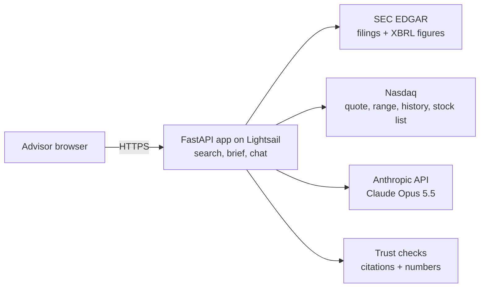

# TickerAgent

A stock brief and chat assistant for wealth advisors. Search a stock, get a one-page brief from Nasdaq market data and the company's latest SEC filings, then ask follow-up questions. Every answer cites the exact passage it came from.

## What it does

- **Find the stock** by ticker or company name ("berkshire" finds BRK/A and BRK/B).
- **Market data (Nasdaq):** last sale with trade time, day change, 52-week range, market cap, dividend, sector, and a one-year price chart.
- **Key figures (SEC XBRL):** revenue, net income, diluted EPS, operating cash flow, debt and cash for the latest fiscal year vs. prior. Rendered from the data, never generated by the model.
- **AI brief (Claude):** what the company does, what's new, what's driving results, key risks, and questions a client may ask. Drawn from the latest 10-K, any newer 10-Q, and 8-Ks from the last 120 days, including earnings press releases.
- **Chat with the data:** plain-English follow-ups such as "What did the November 8-K say about the CEO?" or "How has the stock moved since earnings?", answered only from the loaded filings, figures and prices, with quoted sources.

One screen, no training: a search box, the brief, and a chat panel with suggested questions.

## Status

| Capability | Status |
| --- | --- |
| Brief: SEC filings, XBRL figures, cited AI summary, client questions | Built |
| Citation and number checks, no-model fallback | Built, tested |
| Nasdaq market data and company-name search | Built, tested |
| Claude API (Anthropic SDK) | Built, tested with a stand-in model; live call pending an API key |
| Chat with citations | Built, tested with a stand-in model; live run pending an API key |
| Release eval for hallucination checks | Built (31 questions); first live run pending an API key |
| Deployment on Amazon Lightsail | Planned |

Plan and progress: [docs/DEV_PLAN.md](docs/DEV_PLAN.md). Requirements: [docs/PRD.md](docs/PRD.md). Architecture and diagrams: [docs/ARCHITECTURE.md](docs/ARCHITECTURE.md).

## How it avoids hallucinations

| Safeguard | How |
| --- | --- |
| Closed book | The model sees only the documents loaded for that stock and is told not to use outside knowledge |
| Passage-level citations | Chat uses Claude's built-in citations; each factual sentence links to the exact quoted passage |
| Number check | Every number in an answer must appear in its cited passage or the market and figures data, or it is flagged "check" |
| Uncited figures | Removed from the brief; flagged "unverified" in chat |
| Says "not in the data" | Questions the loaded data cannot answer get that answer, not a guess |
| Numbers from code | Prices and reported figures are rendered from Nasdaq and SEC data, not written by the model |
| No advice | No buy/sell/hold, price targets or predictions; analyst targets are excluded from the data |
| Release eval | Answerable, unanswerable, advice-seeking and injection questions run before each deploy |

## Architecture



A fixed pipeline rather than a tool-calling agent: the data each answer needs is always the same, so a pipeline is faster, cheaper and easier to audit. Full diagrams and request flows: [docs/ARCHITECTURE.md](docs/ARCHITECTURE.md). Build decisions: [docs/DESIGN.md](docs/DESIGN.md).

| File | Role |
| --- | --- |
| `src/ticker_agent/sec.py` | EDGAR access, filing text extraction, XBRL figures, 6-hour local cache |
| `src/ticker_agent/nasdaq.py` | Stock search, quote, summary, daily history; analyst target removed |
| `src/ticker_agent/gather.py` | The loaded data set for one stock, shared by the brief and chat |
| `src/ticker_agent/llm.py` | Claude client (Anthropic SDK): structured brief call, streamed cited chat, refusal fallback, friendly errors |
| `src/ticker_agent/brief.py` | Brief orchestration, prompt, citation and number checks, fallback |
| `src/ticker_agent/chat.py` | Chat over the loaded documents: cited documents, closed-book prompt, number and uncited-figure checks, streamed events |
| `src/ticker_agent/app.py` | FastAPI: page, search, brief, chat, health check |
| `src/ticker_agent/static/index.html` | Single-page UI, no build step |
| `eval/questions.json`, `eval/release_eval.py` | Release eval: questions, scoring, report in `docs/EVAL.md` |

## Run locally

```bash
python3.12 -m venv .venv && . .venv/bin/activate
pip install -r requirements-dev.txt
cp .env.example .env        # add your Anthropic API key and SEC contact email
uvicorn ticker_agent.app:app --app-dir src --port 8000
# open http://127.0.0.1:8000
```

Without an API key the app still runs and shows market data, figures and quoted filing excerpts.

## Test

```bash
pytest -q
```

Unit tests use a stand-in model and recorded responses: citation handling, number flags, fallbacks and input validation. The release eval runs against the live model: `PYTHONPATH=src python eval/release_eval.py` (results in [docs/EVAL.md](docs/EVAL.md)).

## Deploy

Local container:

```bash
docker build -t ticker-agent .
docker run -p 8000:8000 --env-file .env ticker-agent
```

Hosted: Amazon Lightsail container service (micro, one node, health check `/healthz`, public HTTPS URL), with the image built by GitHub Actions. `ANTHROPIC_API_KEY`, `ANTHROPIC_MODEL` and `SEC_USER_AGENT` are set as deployment environment variables and are never committed. Exact commands land with the deployment.

## Data sources and limits

- **SEC EDGAR** public APIs and filing documents. No API key. Used under SEC fair-access guidance: declared client name and contact email, under 10 requests/second, cached.
- **Nasdaq** public website data for quotes, history and the stock list. No key, but not a documented API, so it sits behind one module that a licensed feed would replace in production.
- **Claude** via the Anthropic API.
- Some filers (large banks, for example) put management's discussion in an annual-report exhibit; that section comes back thin and the brief says so.

For advisor preparation only. Not investment advice.
