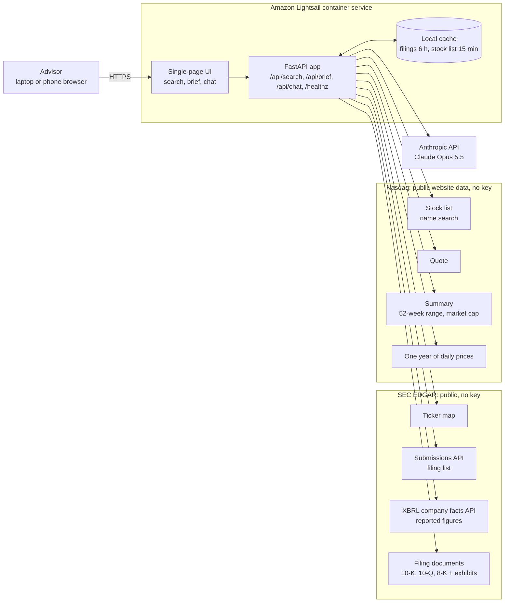
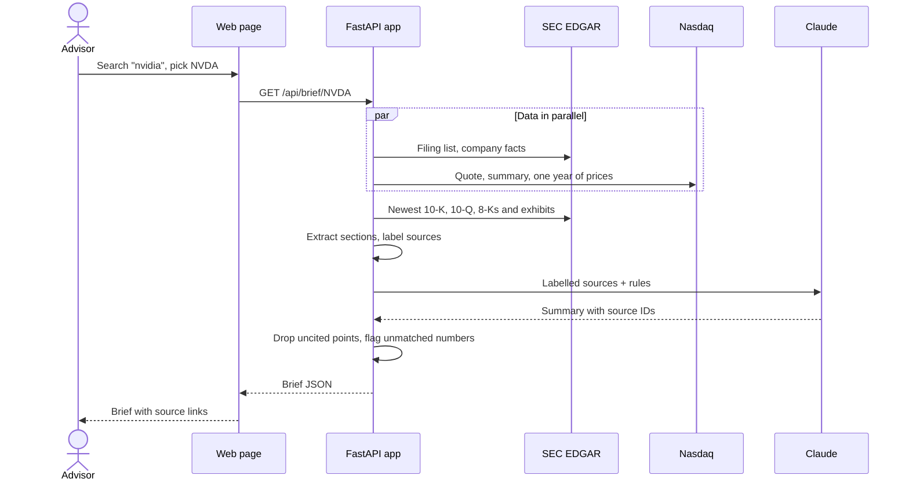
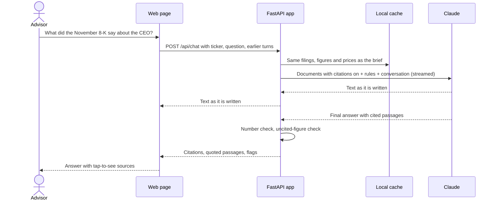
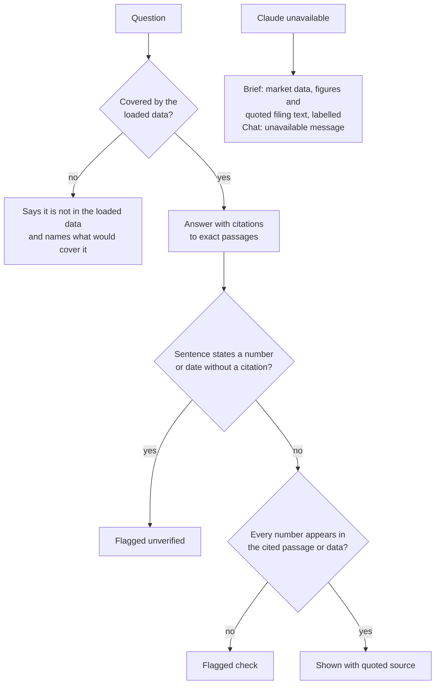
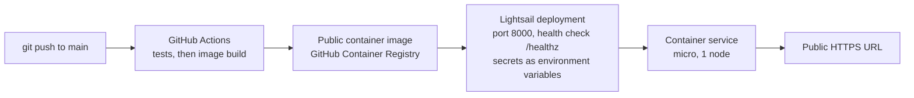

# Architecture

TickerAgent is one small web service. It gathers public data for a stock, asks Claude to summarize or answer only from that data, checks the output against the sources, and serves the result to a single-page UI.

Status: **built** = working in the repo today; **planned** = in the PRD and [DEV_PLAN.md](DEV_PLAN.md), being built next.

## System overview

## Components

| Component | File | Responsibility | Status |
| --- | --- | --- | --- |
| EDGAR client | `src/ticker_agent/sec.py` | Ticker lookup, newest filings, section extraction, exhibit lookup, XBRL figures, polite rate limiting, cache | built |
| Nasdaq client | `src/ticker_agent/nasdaq.py` | Stock-list search, quote, summary, daily history; drops analyst price targets; each part fails on its own | built |
| Model client | `src/ticker_agent/llm.py` | Anthropic SDK: one structured-output call for the brief, a streaming call with citations for chat; server-side refusal fallback; errors mapped to friendly messages | built (live call pending an API key) |
| Data set | `src/ticker_agent/gather.py` | Resolves the ticker with SEC, gathers filings, figures and Nasdaq data in parallel, keeps the set for 5 minutes for chat | built |
| Brief builder | `src/ticker_agent/brief.py` | Gathers data in parallel, labels sources, prompts the model, runs the trust checks, falls back without the model | built |
| Chat | `src/ticker_agent/chat.py` | Builds the cited document set, streams the answer, runs the trust checks | built (live run pending an API key) |
| Guard | `src/ticker_agent/guard.py` | Per-visitor rate limit and daily AI-call cap for the public URL, configured by environment | built |
| Web API | `src/ticker_agent/app.py` | `GET /api/search`, `GET /api/brief/{ticker}`, `POST /api/chat` (streamed), `GET /healthz`, input validation | built |
| UI | `src/ticker_agent/static/index.html` | Search box, brief, chat panel with suggested questions and quote-on-tap citations; no build step | built |

## The loaded data set

Everything the model may use for one stock. Each item is passed to Claude as a separate document with citations enabled, so every cited sentence points at an exact passage.

| Source | Content | Origin |
| --- | --- | --- |
| `S1`..`Sn` | Filing sections: 10-K Items 1, 1A, 7; 10-Q MD&A and risk updates; 8-K text and press-release exhibit | EDGAR filing documents |
| `F` | Reported figures, latest fiscal year and prior year | EDGAR XBRL company facts |
| `Q` | Quote, day change, 52-week range, market cap, dividend, sector | Nasdaq quote and summary (analyst target removed) |
| `P` | One year of daily open, high, low, close, volume | Nasdaq historical |

## Brief request

## Chat request

The server keeps no conversation state. The page sends the ticker, the question and the earlier turns; the server rebuilds the data set from its cache. Any container can answer any request, and there is no database to run. The loaded documents sit at the start of every request, so prompt caching makes later turns faster and cheaper.

## Trust checks

The prompt adds the remaining rules: no outside knowledge, no recommendations, price targets or predictions, and filing text is data rather than instructions. A release eval set (answerable, unanswerable, advice-seeking and injection questions) checks all of this before each deployment.

## Deployment on Amazon Lightsail

| Setting | Value |
| --- | --- |
| Service type | Lightsail container service: managed HTTPS endpoint, no server to patch |
| Size | Micro (1 GB memory), headroom for parsing large 10-K documents |
| Image | Built and published by GitHub Actions on each push to `main`; Lightsail pulls the public image. If Lightsail cannot pull from that registry, the image is pushed directly with `aws lightsail push-container-image`. |
| Container port | 8000; `$PORT` is honoured if set |
| Health check | `GET /healthz` |
| Environment | `ANTHROPIC_API_KEY`, `ANTHROPIC_MODEL`, `SEC_USER_AGENT`, rate-limit settings; set at deploy time, never committed |
| Cache | Container-local `/tmp`; lost on redeploy, which only costs one slower first request per stock |

Chat streams, so the advisor sees text at once and long answers do not hit request timeouts. The brief call is checked against the Lightsail endpoint's timeout during the deploy step.

## Key decisions

| Decision | Why |
| --- | --- |
| Fixed pipeline instead of a tool-calling agent | The data a brief needs is always the same, so a pipeline is faster, cheaper and easier to audit. Agent-style retrieval (older filings, peers, full-text search) is a roadmap item for chat. |
| Claude's built-in citations for chat | Each sentence links to an exact quoted passage returned by the API, which is stronger than asking the model to write source IDs. |
| Figures and prices from code, words from the model | The numbers an advisor is most likely to quote never come from the model. |
| Stateless chat | Scales across containers with no session store; the cache makes rebuilding the data set cheap. |
| Official EDGAR APIs, not page scraping | No key needed, same-day freshness, within SEC fair-access guidance. |
| Nasdaq behind one adapter | Covers quote, range, history and name search with no key; one module to replace with a licensed feed. |
| One container on Lightsail | The simplest managed option with HTTPS for a prototype. Production adds SSO, an audit log and licensed data (see the PRD). |
